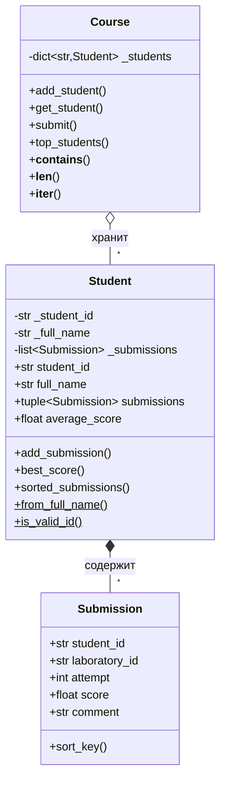
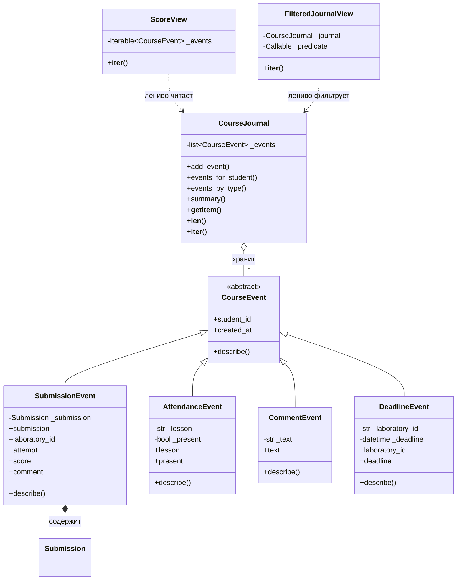

# Лабораторная работа № 4. Итераторы, генераторы и объектная модель Python

## Введение

В работе исследованы протокол итерации Python, ленивые вычисления на основе
генераторов и объектная модель языка: классы, композиция, наследование,
`dataclass`, свойства и специальные методы.

Все пять сценариев находятся в директории `solutions/lab 4` и запускаются
независимо:

```bash
cd "solutions/lab 4"
python3 task_1.py
python3 task_2.py
python3 task_3.py
python3 task_4.py
python3 task_5.py
```

Каждый файл завершается без необработанных исключений. Намеренно ошибочные
вызовы либо закомментированы, либо обёрнуты в `try/except` для фиксации
ожидаемого исключения в демонстрационном выводе.

---

## Задание 1. Протокол итерации

### 1.1. Исследование `iter()` и `next()`

Исходный сценарий:

```python
values = [10, 20, 30]
iterator = iter(values)

print(iterator is values)
print(iter(iterator) is iterator)
print(next(iterator))
print(next(iterator))
print(next(iterator))
```

Полученный результат:

```text
iterator is values: False
iter(iterator) is iterator: True
next(iterator): 10
next(iterator): 20
next(iterator): 30
четвёртый next(iterator): StopIteration
```

Четвёртый вызов `next()` приводит к `StopIteration`. В файле
`task_1.py` он оставлен в `try/except`, чтобы показать исключение, а строка
`next(iterator)` в обычном виде закомментирована — файл завершается без
ошибки.

Выводы:

- список является **итерируемым объектом** (iterable), но не итератором:
  `iter(values)` создаёт отдельный объект-итератор;
- итератор возвращает себя из `__iter__`, поэтому
  `iter(iterator) is iterator` истинно;
- после исчерпания итератор остаётся исчерпанным: повторные вызовы
  `next()` продолжают возбуждать `StopIteration`.

### 1.2. Функция `consume()`

```python
def consume(iterable) -> list:
    """Собирает элементы iterable, вручную используя iter() и next()."""
    result = []
    iterator = iter(iterable)
    while True:
        try:
            result.append(next(iterator))
        except StopIteration:
            return result
```

Цикл `for`, преобразование `list(iterable)` и готовые функции накопления
внутри функции не используются. Завершение определяется только по
`StopIteration`.

Результаты проверки:

| Источник | Результат `consume()` |
|---|---|
| `[1, 2, 3]` | `[1, 2, 3]` |
| `(4, 5, 6)` | `[4, 5, 6]` |
| `"abc"` | `['a', 'b', 'c']` |
| `range(3)` | `[0, 1, 2]` |
| частично использованный итератор после `next() == 10` | `[20, 30, 40]` |

### 1.3. Повторный обход списка и его итератора

```text
повторный consume(список):    [1, 2, 3] [1, 2, 3]
повторный consume(итератор):  [1, 2, 3] []
```

Список — повторно итерируемый объект: каждый вызов `iter()` создаёт новый
итератор, поэтому оба обхода начинаются с начала. Итератор хранит текущую
позицию внутри себя и одновременно является своим же итератором. После
первого полного обхода его состояние остаётся в конце, поэтому второй вызов
`consume()` получает уже пустую последовательность.

### 1.4. `my_enumerate()` и `my_zip()`

```python
def my_enumerate(iterable, start=0):
    iterator = iter(iterable)
    index = start
    while True:
        try:
            value = next(iterator)
        except StopIteration:
            return
        yield index, value
        index += 1
```

```python
def my_zip(first, second):
    first_iterator = iter(first)
    second_iterator = iter(second)
    while True:
        try:
            first_value = next(first_iterator)
            second_value = next(second_iterator)
        except StopIteration:
            return
        yield first_value, second_value
```

Обе функции работают с любыми итерируемыми объектами. `my_zip()` читает
источники параллельно и завершается по самому короткому из них.

Результаты:

```text
my_enumerate(["a", "b", "c"])       -> [(0, 'a'), (1, 'b'), (2, 'c')]
my_enumerate("xyz", start=5)        -> [(5, 'x'), (6, 'y'), (7, 'z')]
my_enumerate(генератор)             -> [(0, 0), (1, 1), (2, 4), (3, 9)]
my_enumerate(StepRange(2, 11, 3))   -> [(1, 2), (2, 5), (3, 8)]

my_zip([1, 2, 3], "ab")             -> [(1, 'a'), (2, 'b')]
my_zip("abc", (10, 20))             -> [('a', 10), ('b', 20)]
my_zip(генератор, range(3))         -> [(0, 0), (1, 1), (2, 2)]
my_zip(StepRange(0, 6, 2), "abcd")  -> [(0, 'a'), (2, 'b'), (4, 'c')]
```

### 1.5. Ответы на вопросы для анализа

1. **Что должен возвращать `iter()` для итерируемого объекта?**
   Объект-итератор, то есть объект, у которого есть метод `__next__()`,
   возвращающий следующее значение или возбуждающий `StopIteration`.
   Для итерируемого объекта `iter()` обычно создаёт новый итератор; если
   объект уже является итератором, он может вернуть самого себя.

2. **Что должен делать `next()` после исчерпания данных?**
   Возбуждать исключение `StopIteration`. После этого итератор остаётся
   исчерпанным: последующие вызовы `next()` также возбуждают
   `StopIteration`, если итератор не реализует специальное повторное
   заполнение.

3. **Почему итератор обычно возвращает себя при вызове `iter(iterator)`?**
   Чтобы итератор сам удовлетворял протоколу итерируемого объекта. Тогда
   его можно передавать в `for`, `list()`, `sum()` и другие функции,
   ожидающие iterable. Если бы `iter(iterator)` создавал новый итератор,
   текущая позиция терялась бы, а обход мог бы начаться заново или
   зациклиться.

---

## Задание 2. Собственный итератор `StepRange`

### 2.1. Архитектура

`StepRange` хранит только три целых числа: `start`, `stop`, `step`.
Список значений не создаётся. Каждый вызов `__iter__()` возвращает новый
объект `StepRangeIterator`, который хранит собственное текущее значение
`current`.

```python
class StepRange:
    def __iter__(self):
        return StepRangeIterator(self)


class StepRangeIterator:
    def __iter__(self):
        return self

    def __next__(self):
        if self._step_range.step > 0:
            if self._current >= self._step_range.stop:
                raise StopIteration
        else:
            if self._current <= self._step_range.stop:
                raise StopIteration

        value = self._current
        self._current += self._step_range.step
        return value
```

Нулевой шаг отклоняется в конструкторе:

```text
ValueError: Шаг step не может быть равен нулю
```

Поддерживаются положительный и отрицательный шаги. Для отрицательного шага
диапазон идёт от `start` вниз, не включая `stop`.

### 2.2. Проверка основных случаев

| Выражение | Результат |
|---|---|
| `list(StepRange(0, 5, 1))` | `[0, 1, 2, 3, 4]` |
| `list(StepRange(5, 0, -1))` | `[5, 4, 3, 2, 1]` |
| `list(StepRange(0, 0, 1))` | `[]` |
| `list(StepRange(0, 5, -1))` | `[]` |
| `list(StepRange(2, 11, 3))` | `[2, 5, 8]` |

Повторный обход работает:

```text
первый обход:  [2, 5, 8]
второй обход:  [2, 5, 8]
```

### 2.3. Состояние двух независимых итераторов

Для `StepRange(0, 6, 2)` созданы два итератора `first` и `second`.
`current` — значение, которое будет возвращено следующим вызовом `next()`.

| Шаг | Вызов | Результат | `first.current` | `second.current` |
|---:|---|---|---:|---:|
| 0 | — | — | 0 | 0 |
| 1 | `next(first)` | 0 | 2 | 0 |
| 2 | `next(second)` | 0 | 2 | 2 |
| 3 | `next(first)` | 2 | 4 | 2 |
| 4 | `next(second)` | 2 | 4 | 4 |
| 5 | `next(first)` | 4 | 6 | 4 |
| 6 | `next(second)` | 4 | 6 | 6 |
| 7 | `next(first)` | `StopIteration` | 6 | 6 |
| 8 | `next(second)` | `StopIteration` | 6 | 6 |

Итераторы не влияют друг на друга: изменение `first.current` не меняет
`second.current`.

### 2.4. `len()`, `__contains__()` и `__repr__()`

Количество элементов вычисляется по формуле, без перебора:

- для положительного шага:
  `max(0, (stop - start + step - 1) // step)`;
- для отрицательного шага:
  `max(0, (stop - start + step + 1) // step)`.

Проверка принадлежности также выполняется вычислением:

```python
if step > 0:
    inside = start <= value < stop
else:
    inside = stop < value <= start
return inside and (value - start) % step == 0
```

Результаты:

```text
len(StepRange(2, 11, 3)):   3
len(StepRange(11, 2, -3)):  3
5 in StepRange(2, 11, 3):   True
6 in StepRange(2, 11, 3):   False
100 in StepRange(0, 10, 1): False
repr: StepRange(start=2, stop=11, step=3)
```

Сравнение с явным последовательным перебором для
`StepRange(0, 1_000_000, 1)` и значения `999_999`:

```text
Проверка через __contains__: True
Проверка последовательным перебором: True
Проверено элементов при переборе: 1000000
```

`__contains__()` выполняет фиксированное число арифметических операций
(O(1)), а перебор — O(n). На больших диапазонах разница принципиальна.

### 2.5. Ответы на вопросы для анализа

1. **Почему состояние обхода лучше хранить в отдельном объекте?**
   Тогда сам диапазон остаётся неизменяемым описанием последовательности,
   а каждый обход получает независимую позицию. Это позволяет повторно
   обходить один объект, использовать вложенные циклы и несколько
   потребителей одновременно без взаимного влияния.

2. **Что произойдёт, если `__iter__()` всегда будет возвращать один и тот же
   изменяемый итератор?**
   Все циклы и потребители будут делить одну позицию. Второй обход начнётся
   не с начала, а с текущего места; вложенный цикл по тому же объекту
   «съест» данные внешнего; после исчерпания объект нельзя будет обойти
   повторно без ручного сброса.

3. **Сколько памяти относительно числа элементов требует `StepRange`?**
   O(1): хранятся только `start`, `stop`, `step`. Каждый итератор добавляет
   ещё одно целое число `current`. Память не зависит от количества
   элементов.

---

## Задание 3. Генераторы и ленивый конвейер

### 3.1. Реализованные генераторы

- `read_measurements(lines)` — пропускает пустые строки, преобразует
  остальные в `float` и выдаёт их через `yield`;
- `filter_range(values, minimum, maximum)` — пропускает значения из
  закрытого диапазона `[minimum, maximum]`;
- `moving_average(values, window_size)` — хранит `deque` длиной не больше
  `window_size` и выдаёт среднее после заполнения окна;
- `take(n, iterable)`, `drop(n, iterable)`, `batch(iterable, size)` —
  универсальные ленивые операции без материализации всего источника.

Некорректный размер окна отклоняется:

```text
ValueError: window_size должен быть положительным
```

### 3.2. Работа конвейера

Исходные данные:

```python
raw_lines = ["10.0", "", "12.5", "100.0", "11.5", "13.0", "9.5"]
```

Конвейер: строки → числа → фильтрация `[9; 20]` → скользящее среднее с
окном 2.

```text
Исходные строки: ['10.0', '', '12.5', '100.0', '11.5', '13.0', '9.5']
первые два значения через next(): 11.25 12.0
оставшиеся значения: [12.25, 11.25]
исходный список не изменился: True
```

Промежуточные последовательности не превращаются в списки: `read_measurements`,
`filter_range` и `moving_average` являются генераторами. Исходный список не
изменяется.

После исчерпания:

```text
исчерпанный генератор: []
новый конвейер:        [11.25, 12.0, 12.25, 11.25]
```

Генератор одноразовый: после `StopIteration` он не перезапускается. Чтобы
получить данные заново, нужно создать новый генератор/конвейер.

### 3.3. Включения и генераторные выражения

Полученные результаты:

```text
квадраты чётных чисел от 1 до 20:
[4, 16, 36, 64, 100, 144, 196, 256, 324, 400]

множество длин непустых строк:
[3, 5, 6]

словарь число → квадрат:
{1: 1, 2: 4, 3: 9, 4: 16, 5: 25, 6: 36, 7: 49, 8: 64, 9: 81, 10: 100}

сумма квадратов от 1 до 1 000 000:
333333833333500000
```

Различия:

- **list/set/dict-comprehension** вычисляются сразу и создают готовую
  коллекцию. Время — сразу для всех элементов, память — O(n).
- **Генераторное выражение** создаёт ленивый генератор. Элементы
  вычисляются по одному по мере запроса; память — O(1) относительно
  количества элементов (не считая источника и текущего состояния).
  Повторный обход невозможен без создания нового выражения.

В `sum(number**2 for number in range(1_000_001))` генераторное выражение
позволяет не хранить миллион квадратов: сумма накапливается по мере
вычисления.

### 3.4. `take()`, `drop()` и `batch()`

```text
take(3):       [10.0, 12.5, 11.5]
drop(2):       [11.5, 13.0, 9.5]
batch(..., 2): [(11.25, 12.0), (12.25, 11.25)]
```

- `take()` читает только запрошенное количество элементов;
- `drop()` пропускает `n` элементов и затем выдаёт остаток;
- `batch()` хранит только текущий пакет, а не весь источник.

### 3.5. Сравнение памяти с помощью `tracemalloc`

Оба варианта обрабатывают 100 000 строк; исходный список создаётся до
начала измерения, поэтому сравнивается именно память обработки.
Ленивый вариант использует генераторы, жадный — создаёт новый список на
каждом этапе.

| Вариант | Пиковая память | Обработано значений |
|---|---:|---:|
| Ленивый конвейер | 2.8 КиБ | 99 996 |
| Жадный конвейер (списки на каждом этапе) | 7035.6 КиБ | 99 996 |
| Отношение | ≈ 2537× | — |

Значения могут немного отличаться при повторном запуске из-за работы
аллокатора, но соотношение сохраняется: ленивый конвейер не хранит
промежуточные коллекции, а жадный хранит сразу несколько списков по
100 000 элементов.

### 3.6. Вывод по заданию 3

Генераторы разделяют **описание вычисления** и **момент его выполнения**.
Конвейер не выполняет работу, пока к нему не обратились через `next()`,
`list()` или другой потребитель. Это уменьшает память, позволяет работать
с бесконечными источниками и обрабатывать только нужный префикс данных.
Платой является одноразовость генератора и необходимость создавать новый
конвейер для повторного обхода.

---

## Задание 4. Модель предметной области

### 4.1. Mermaid-диаграмма классов



`Course` агрегирует студентов (студент может существовать независимо от
курса), а `Student` композиционно содержит свои попытки сдачи. `Submission`
не знает о `Student` и `Course`, что снижает связанность.

### 4.2. Где используется композиция

- `Student` содержит `list[Submission]` и отвечает за добавление работ.
  Студент не является списком работ — он **имеет** работы.
- `Course` содержит словарь `dict[str, Student]` и предоставляет операции
  курса, не наследуя поведение студента.
- В задании 5 `SubmissionEvent` содержит объект `Submission`, а
  `CourseJournal` содержит события. Это тоже композиция.

### 4.3. Почему наследование `Student` от `Submission` было бы некорректным

1. Нарушается отношение «is-a»: студент не является попыткой сдачи работы.
2. `Student` получил бы поля `laboratory_id`, `attempt`, `score`, `comment`,
   которые описывают не студента, а конкретную сдачу.
3. Возникла бы путаница ответственности: студент хранит много попыток, а
   наследник `Submission` описывает одну попытку. Пришлось бы переопределять
   почти всё поведение.
4. Нарушался бы принцип подстановки Лисков: код, ожидающий `Submission`,
   получал бы объект с другим смыслом `score` и `attempt`.
5. Изменились бы жизненный цикл и инварианты: у попытки неизменяемые поля,
   а студент должен накапливать новые работы.

Правильное решение — композиция: `Student` **содержит** `Submission`.

### 4.4. Инварианты классов

| Класс | Защищаемые инварианты |
|---|---|
| `Submission` | `student_id` и `laboratory_id` — непустые строки; `attempt > 0`; `0 <= score <= 100`; `comment` — строка; объект неизменяем благодаря `frozen=True` |
| `Student` | идентификатор проходит `is_valid_id()`; имя непустое и нормализовано; все работы принадлежат этому студенту; `submissions` возвращает кортеж, а не внутренний список; средний балл пустого студента равен `0.0` |
| `Course` | идентификаторы студентов уникальны; `get_student()` не создаёт студента; `top_students()` не изменяет реестр; `limit <= 0` даёт пустой список |
| `CourseEvent` и наследники | непустой `student_id`; `created_at` — `datetime`; обязательный `describe()`; поля наследников проверяются в их конструкторах |
| `CourseJournal` | хранит только `CourseEvent`; сохраняет порядок добавления; срез возвращает кортеж; `summary()` не раскрывает внутренний список |

### 4.5. Стандартные операции с объектами

```text
len(course): 3
iter(course): Иван Петров, Анна Смирнова, Борис Кузнецов
'S-002' in course: True
'S-999' in course: False

len(ivan): 3
ivan.average_score: 83.67
ivan.best_score('lab_01'): 91.0
ivan.best_score('lab_99'): None
```

- `len(course)` вызывает `Course.__len__()`;
- `for student in course` и `iter(course)` используют `__iter__()`;
- `'S-002' in course` вызывает `Course.__contains__()`;
- `len(ivan)` вызывает `Student.__len__()` и возвращает число попыток;
- `for submission in ivan` работает через `Student.__iter__()`;
- `ivan.submissions` — кортеж, поэтому внешний код не может изменить
  внутренний список (попытка `append` приводит к `AttributeError`).

### 4.6. Сравнение и сортировка работ

`Submission` оформлен как `@dataclass(frozen=True)`. Python автоматически
генерирует сравнение по содержимому всех полей и хеширование:

```text
first == second: True
first is second: False
first == third: False
hash(first) == hash(second): True
```

Сортировка выполняется по ключу `(attempt, score)` и возвращает новый
список. Внутренний порядок не меняется:

```text
порядок добавления:
  lab_02, попытка 1, 88.0
  lab_01, попытка 1, 72.0
  lab_01, попытка 2, 91.0

отсортированное представление:
  lab_01, попытка 1, 72.0
  lab_02, попытка 1, 88.0
  lab_01, попытка 2, 91.0

внутренний порядок после сортировки:
  [(1, 'lab_02'), (1, 'lab_01'), (2, 'lab_01')]
```

### 4.7. Альтернативный конструктор и статический метод

`Student.from_full_name()` нормализует пробелы и регистр:

```text
"  иВАН   петров " -> "Иван Петров"
```

`Student.is_valid_id()` — статический метод, не требующий экземпляра:

```text
Student.is_valid_id('S-010'): True
Student.is_valid_id('   '):   False
Student.is_valid_id(10):      False
```

---

## Задание 5. Расширяемый журнал учебного курса

### 5.1. Иерархия событий



`CourseEvent` — абстрактный класс (`ABC`). В нём объявлены абстрактное
свойство `student_id` и абстрактный метод `describe()`, а также общее
свойство `created_at`. Каждый наследник реализует `student_id` и
`describe()` и хранит только свои данные:

- `SubmissionEvent` — объект `Submission`;
- `AttendanceEvent` — название занятия и признак присутствия;
- `CommentEvent` — текст обратной связи;
- `DeadlineEvent` — работу и срок сдачи.

`DeadlineEvent` добавлен после реализации `render_timeline()` и не потребовал
изменения этой функции.

### 5.2. Протоколы `CourseJournal`

```text
len(journal): 11
journal[0]: S-001: сдача lab_01, попытка 1, результат 72 ...
journal[-1]: S-003: сдача lab_02, попытка 1, результат 75
```

Срез `journal[2:6]` возвращает кортеж из четырёх событий:

```text
S-001: комментарий «Разберитесь с ленивым выполнением генераторов»
S-002: сдача lab_01, попытка 1, результат 95 (Отличная работа)
S-003: сдача lab_01, попытка 1, результат 64
S-002: посетил(а) занятие «Итераторы и генераторы»
```

Реализованы:

- `__len__()` — число событий;
- `__iter__()` — обход в порядке добавления;
- `__getitem__()` — индекс и срез (срез возвращает кортеж, а не внутренний
  список);
- `events_for_student()` и `events_by_type()` — ленивые генераторы;
- `summary()` — новый словарь агрегатов, не содержащий внутренний список.

Пример `summary()` до добавления дедлайна:

```text
{'average_score': 81.0,
 'by_student': {'S-001': 4, 'S-002': 3, 'S-003': 4},
 'by_type': {'AttendanceEvent': 3, 'CommentEvent': 2, 'SubmissionEvent': 6},
 'students': ('S-001', 'S-002', 'S-003'),
 'submission_count': 6,
 'total_events': 11}
```

### 5.3. Полиморфная обработка

```python
def render_timeline(events) -> str:
    """Формирует временную шкалу, вызывая describe() у каждого события."""
    lines = [
        f"{event.created_at:%d.%m.%Y %H:%M} — {event.describe()}"
        for event in events
    ]
    return "\n".join(lines) if lines else "Событий нет."
```

Функция не содержит цепочки `isinstance`: она работает с любым объектом,
у которого есть `created_at` и `describe()`. Поэтому добавление
`DeadlineEvent` не требует изменений:

```text
20.11.2026 11:00 — S-003: сдача lab_02, попытка 1, результат 75
20.11.2026 11:10 — S-003: срок сдачи lab_02 — 01.12.2026 23:59
```

### 5.4. `ScoreView`

`ScoreView` — отдельный итерируемый объект, который при каждом обходе
создаёт новый генератор и выдаёт только результаты `SubmissionEvent`:

```text
первый обход:  [72.0, 95.0, 64.0, 91.0, 89.0, 75.0]
второй обход:  [72.0, 95.0, 64.0, 91.0, 89.0, 75.0]
len(score_view): 6
средний результат: 81.00
лучший результат:  95.0
```

Представление не копирует события и не создаёт список результатов: фильтрация
выполняется во время итерации. Повторный обход возможен потому, что источник
(`CourseJournal`) повторно итерируем, а `__iter__()` создаёт новый генератор.

### 5.5. Демонстрационный сценарий

В сценарии `task_5.py`:

- три студента (`S-001`, `S-002`, `S-003`);
- одиннадцать событий до расширения и двенадцать после добавления
  `DeadlineEvent`;
- шесть событий сдачи, включая две попытки `S-001` по `lab_01`
  (72 и 91 балл);
- события трёх типов плюс `DeadlineEvent`;
- выборки по студенту и по типу;
- срез журнала;
- временная шкала через `render_timeline()`;
- статистика через `ScoreView`;
- фильтрация через именованную функцию и `lambda`.

После добавления дедлайна `summary()` автоматически учитывает новый тип:

```text
{'average_score': 81.0,
 'by_student': {'S-001': 4, 'S-002': 3, 'S-003': 5},
 'by_type': {'AttendanceEvent': 3,
             'CommentEvent': 2,
             'DeadlineEvent': 1,
             'SubmissionEvent': 6},
 'students': ('S-001', 'S-002', 'S-003'),
 'submission_count': 6,
 'total_events': 12}
```

### 5.6. `FilteredJournalView`

```python
class FilteredJournalView:
    def __init__(self, journal, predicate):
        self._journal = journal
        self._predicate = predicate

    def __iter__(self):
        for event in self._journal:
            if self._predicate(event):
                yield event
```

Именованная функция:

```text
первый обход:
  S-001: сдача lab_01, попытка 1, результат 72 ...
  S-001: посетил(а) занятие «Итераторы и генераторы»
  S-001: комментарий «Разберитесь с ленивым выполнением генераторов»
  S-001: сдача lab_01, попытка 2, результат 91 ...
повторный обход:
  ['SubmissionEvent', 'AttendanceEvent', 'CommentEvent', 'SubmissionEvent']
```

`lambda`-фильтр по высоким результатам:

```text
S-002: сдача lab_01, попытка 1, результат 95 (Отличная работа)
S-001: сдача lab_01, попытка 2, результат 91 (Замечания исправлены)
S-002: сдача lab_02, попытка 1, результат 89
```

Представление ленивое: события отбираются во время обхода, а повторный
обход создаёт новый генератор.

### 5.7. Сравнение механизмов расширения

| Механизм | Где применён | Почему |
|---|---|---|
| **Наследование** | `CourseEvent` → `SubmissionEvent`, `AttendanceEvent`, `CommentEvent`, `DeadlineEvent` | Все события образуют отношение «is-a», имеют общий интерфейс `describe()` и `created_at`; полиморфная обработка не требует проверки типа |
| **Композиция** | `Student` → `Submission`, `Course` → `Student`, `SubmissionEvent` → `Submission`, `CourseJournal` → `CourseEvent` | Объекты имеют разную ответственность и жизненный цикл; композиция позволяет переиспользовать поведение без наследования неподходящих полей |
| **Протоколы Python** | `__len__`, `__iter__`, `__getitem__`, `__contains__`, `__str__`, `__repr__`, `__eq__` | Встроенные операции языка автоматически работают с пользовательскими объектами: `len()`, `for`, `in`, индексация, срезы, `print()`, сравнение |
| **Утиная типизация / интерфейс** | `render_timeline(events)` | Функции достаточно `created_at` и `describe()`; цепочка `isinstance` не нужна, поэтому новый тип события подключается без изменения функции |

Наследование не использовалось между `Student` и `Submission`, потому что
это отношение не «is-a». Протоколы не заменяют наследование событий: они
отвечают за интеграцию с синтаксисом языка, а не за общую реализацию
предметных типов.

---

## Ответы на вопросы для анализа

Ответы по заданиям 1 и 2 приведены в разделах 1.5 и 2.5. Дополнительно
обобщим их:

1. `iter()` возвращает итератор, а не копию коллекции. Итератор обязан
   реализовать `__next__()`, а для использования в `for` — ещё и
   `__iter__()`.
2. После исчерпания `next()` возбуждает `StopIteration`. Это штатный способ
   сообщить циклу `for` о завершении, а не ошибка программы.
3. Итератор возвращает себя из `__iter__()`, чтобы быть одновременно
   итерируемым объектом и сохранять текущую позицию.
4. Состояние обхода должно быть отдельным, чтобы один и тот же диапазон
   можно было обходить независимо и повторно.
5. Ленивые генераторы экономят память и позволяют обрабатывать только
   нужную часть данных, но одноразовы; включения создают готовую коллекцию
   сразу и занимают O(n) памяти.

---

## Итоговый вывод

Python Data Model связывает привычный синтаксис языка со специальными
методами классов:

- `for` и `iter()` используют `__iter__()` и `__next__()`;
- `len(obj)` вызывает `__len__()`;
- `obj[key]` и срезы вызывают `__getitem__()`;
- `item in obj` вызывает `__contains__()`;
- `str(obj)` и `repr(obj)` вызывают `__str__()` и `__repr__()`;
- `obj1 == obj2` вызывает `__eq__()`;
- генераторы автоматически реализуют протокол итератора.

Благодаря этому пользовательские классы `StepRange`, `Course`, `Student`,
`CourseJournal` и `ScoreView` ведут себя как встроенные коллекции: их можно
передавать в `for`, `list()`, `len()`, использовать в операторе `in` и
индексировать. Протокол итерации отделяет источник данных от состояния
обхода; генераторы делают вычисления ленивыми; композиция и наследование
позволяют строить модель предметной области с ясным разделением
ответственности и проверяемыми инвариантами. Наследование применяется там,
где есть отношение «is-a» (иерархия событий), композиция — где объект
«has-a» (студент и его работы, журнал и события), а протоколы обеспечивают
бесшовную интеграцию с синтаксисом и стандартными функциями Python.
